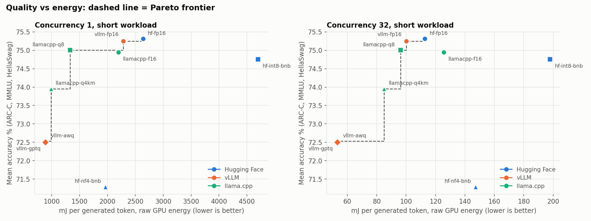

# Quantization benchmark: speed, energy and quality of a 3B model on one GPU

I recently took a machine learning course and an energy efficient computing course in college, and I wanted
to build something that used what I learned in both. This project is the result. I wanted to know what you
actually get when you shrink a language model. How much faster does it run, how much less energy does it use,
and how much worse do its answers get? To find out, I rented and ran Qwen2.5-3B-Instruct on a single RTX 4090 in 9 different
setups and measured all three.

The short version: 4-bit models generate text about 3x faster than the 16-bit Hugging Face baseline and use about
two-thirds less energy per token, and they lose between 1 and 3 points of accuracy. The software you run the model with matters just
as much as the precision, though. One result surprised me: the 8-bit mode in bitsandbytes is much slower than plain 16-bit.

The full explanation is in [docs/WRITEUP.md](docs/WRITEUP.md).



How to read the chart: each dot is one setup. Higher means more accurate, and further left means less energy per token,
so the best setups are in the top left. The dashed line connects the setups that nothing else beats on both.

## Background

**Quantization.** A model is a huge list of numbers called weights. Normally each one is stored in 16 bits.
Quantization stores them in fewer bits, like 8 or 4. It is like saving a photo at lower quality: the file gets much
smaller and usually looks almost the same. A smaller model also tends to run faster, because the GPU has less
data to read for every word it writes. The cost is a small loss in accuracy.

**The three stacks.** These are the programs that load a model and run it on the GPU.
- **Hugging Face Transformers (HF):** the most common one and easy to use. I used it as the baseline.
- **vLLM:** built for speed when many requests arrive at once, like a real chatbot service.
- **llama.cpp:** a lightweight program that runs models almost anywhere. It uses its own file format, GGUF.

**The 4-bit methods.** All of these squeeze a model to about 4 bits per weight, but they choose the numbers differently.
- **NF4 (bitsandbytes):** simple rounding with cleverly spaced steps. No calibration data.
- **AWQ:** runs sample text through the model to find the weights that matter most, and protects them before rounding.
- **GPTQ:** rounds one weight at a time and adjusts the remaining weights to cancel out the error.
- **Q4_K_M (llama.cpp):** llama.cpp's own format, a mix of 4-bit and 6-bit blocks.

Config names look like `stack-precision`, for example `vllm-awq`. `fp16` is the full 16-bit model, `int8` and `q8` are 8-bit.

## Why fewer bits should be faster, and my hypothesis

The idea behind the whole project is this chain:

1. Quantization stores the weights with fewer bits, so they take fewer bytes.
2. To write each token, the GPU has to fetch all the weights from its memory.
3. Fewer bytes means each fetch takes less time.
4. Each token is ready sooner, so the model writes more tokens per second.
5. Faster tokens also mean less energy per token, because the GPU spends less time working on each one.

**Hypothesis:** the fewer bits each weight uses, the more tokens per second the model will write. Energy per token should
drop too, but how much depends on how many requests run at once. With one user, the GPU spends most of its time waiting on
memory, so smaller weights save a lot of time and energy. With many users at once, the GPU shares each memory fetch
between all of them and spends more of its time on math, so shrinking the weights should help less.

I check this against the results below.

## How to read the numbers

- **Token:** the small piece of text a model reads and writes, about three-quarters of a word. 100 tokens is roughly 75 words.
  A model writes its answer one token at a time.
- **Tokens per second:** how fast the model writes. **Higher is better.**
- **mJ per token:** how much GPU energy it takes to write one token. **Lower is better.**
- **c=1 and c=32:** how many requests run at the same time. c=1 is one user. c=32 is a busy service with 32 users at once.
- **Accuracy:** how many test questions the model gets right. **Higher is better.**
- **Perplexity:** how well the model predicts normal text. **Lower is better.**
- **Model size:** how much memory the weights take. **Lower is better**, because a smaller model fits on smaller GPUs and is quicker to read.

## Results

Each row is one setup. The prompt is 128 tokens and each reply is exactly 256 tokens. Every number is the median
of 6 timed runs.

| config | tokens/s (c=1) | mJ per token (c=1) | tokens/s (c=32) | mJ per token (c=32) | model size GB | accuracy % | perplexity |
|---|---|---|---|---|---|---|---|
| hf-fp16 | 88 | 2640 | 2449 | 113 | 6.17 | 75.3 | 8.56 |
| hf-int8-bnb | 19 | 4700 | 482 | 198 | 3.40 | 74.8 | 8.66 |
| hf-nf4-bnb | 61 | 1965 | 1475 | 147 | 2.01 | 71.3 | 9.10 |
| vllm-fp16 | 132 | 2282 | 3351 | 100 | 6.17 | 75.2 | 8.56 |
| vllm-awq | 280 | 906 | 6317 | 54 | 2.69 | 72.5 | 9.10 |
| vllm-gptq | 284 | 885 | 6352 | 53 | 2.07 | 72.5 | 9.22 |
| llamacpp-f16 | 133 | 2197 | 1437 | 126 | 6.80 | 74.9 | 7.73* |
| llamacpp-q8 | 215 | 1330 | 1625 | 96 | 3.62 | 75.0 | 7.75* |
| llamacpp-q4km | 309 | 989 | 1758 | 85 | 2.10 | 74.0 | 7.98* |

Accuracy is the average of three tests (ARC-Challenge, MMLU and HellaSwag), and a difference under about 1 point is just noise.
Perplexity is measured on WikiText-2. \*llama.cpp scores perplexity its own way, so only compare those three numbers with each other.

### What the results mean

**1. Smaller models are faster, because memory speed is the limit.** To write each token, the GPU has to read the whole
model from its memory, like an author rereading the whole book before every word. A 4-bit model is about a third of the
size, so there is less to read. In vLLM and llama.cpp, 4-bit was about 2.2x faster than the same program running 16-bit,
not 3x, because every token also has a small fixed cost that doesn't shrink with the model. (Hugging Face's 4-bit mode
was the exception. See point 3.)

**2. Handling many requests at once saves a lot of energy.** With one user, the GPU reads the whole model to write one word.
With 32 users, it reads the model once and uses that one read to move all 32 conversations forward. It is like one bus
instead of 32 taxis. In my tests, 32 requests cut the energy per token by 12 to 24 times. The GPU only draws a little more
power, but it produces far more tokens. Each user also barely waits longer: Hugging Face 16-bit went from 88 tokens/s
alone to 81 tokens/s per user with 32 users.

**3. The software matters about as much as the number of bits.** The same precision can run at very different speeds
depending on which program runs it:
- Both vLLM AWQ and llama.cpp Q4_K_M are 4-bit. With 32 requests, vLLM made 6,317 tokens/s and llama.cpp made 1,758.
- Hugging Face's 4-bit mode (NF4, from bitsandbytes) was slower than its own 16-bit: 61 tokens/s against 88.
- Both llama.cpp Q8 and Hugging Face 8-bit (bitsandbytes) are 8-bit. llama.cpp ran at 215 tokens/s and bitsandbytes at 19.
  The bitsandbytes 8-bit mode was even about 5x slower than plain 16-bit (88), even though it reads half as many bytes.
  It does extra work on every layer, and that extra work costs more than the memory it saves. I didn't profile it, so that
  is the known reason and not something I measured.

**4. 8-bit costs almost nothing in accuracy. 4-bit costs about 1 to 3 points.** llama.cpp Q4_K_M lost the least, and
bitsandbytes NF4 lost the most (about 4 points).

The long-prompt results (1024 tokens), the c=8 results and every individual run are in
`results/runs.jsonl` and `results/charts/summary.csv`. More charts are in `results/charts/`.

### Did the hypothesis hold?

Mostly, with one clear exception. Here is 16-bit against 4-bit in the same program, with one user and with 32 users:

| program | | total tokens/s, 16-bit to 4-bit | energy per token, 16-bit to 4-bit |
|---|---|---|---|
| vLLM (AWQ) | 1 user | 132 to 278 (2.1x faster) | 2282 to 906 mJ (60% less) |
| vLLM (AWQ) | 32 users | 3351 to 6317 (1.9x faster) | 100 to 54 mJ (46% less) |
| llama.cpp (Q4_K_M) | 1 user | 131 to 297 (2.3x faster) | 2197 to 989 mJ (55% less) |
| llama.cpp (Q4_K_M) | 32 users | 1437 to 1758 (1.2x faster) | 126 to 85 mJ (32% less) |
| Hugging Face (NF4) | 1 user | 88 to 61 (slower) | 2640 to 1965 mJ (26% less) |
| Hugging Face (NF4) | 32 users | 2449 to 1475 (slower) | 113 to 147 mJ (31% more) |

- **Fewer bits meant more tokens per second in vLLM and llama.cpp, as predicted.** It did not in Hugging Face with bitsandbytes,
  where the extra work of unpacking the weights cost more than the memory it saved.
- **The energy saving shrank when more requests ran at once**, as predicted: 60% to 46% in vLLM and 55% to 32% in llama.cpp.
  The gain from fewer bits is still there with many users, just smaller.
- **Hugging Face NF4 is the case where energy went the other way.** With one user it used less energy than 16-bit, but with
  32 users it used more. Smaller weights only help if the software can use that to go faster.

I didn't test why llama.cpp's speedup shrinks so much at 32 users, so I can't say whether it fits the explanation in my hypothesis.

## Which setup for which job

These picks come from my results on one RTX 4090, so they are a guide and not a rule.

| Job | Example | Best pick | Why |
|---|---|---|---|
| One person chatting | A private assistant or coding helper on your own computer | llama.cpp Q4_K_M | Fastest for one user (309 tokens/s), the first word shows up in 35 ms, a 256-token reply takes under a second, and it lost the least accuracy of the 4-bit options (about 1 point). |
| One person, quality matters most | Drafting an important email or report | llama.cpp Q8_0 | 215 tokens/s with no accuracy loss I could measure. |
| Many users at once | A support chatbot or a public API | vLLM with AWQ or GPTQ | About 6,300 tokens/s with 32 requests at once, and about 54 mJ per token. That is the most output for the least energy. |
| Many users, no accuracy loss allowed | A tool where wrong answers are costly | vLLM 16-bit | Same accuracy as the full model (75.2) and still 3,351 tokens/s with 32 requests. |
| Big jobs that run overnight | Summarizing or labeling thousands of documents | vLLM with AWQ or GPTQ | Nobody is waiting, so only total speed and energy matter. With long 1024-token inputs it did about 2,950 tokens/s at 125 mJ per token. |
| A small or shared GPU | Running next to other programs | Any 4-bit model | The weights are only about 2 GB, against 6.2 GB for 16-bit. I only tested a 4090, so I didn't test other GPUs. |
| Quick experiments | Trying a few prompts in a notebook | Hugging Face 16-bit | Easiest to set up, and speed doesn't matter for a few prompts. It is slow at scale. |

What I would avoid for serving: bitsandbytes 8-bit was the slowest and used the most energy per token (4,700 mJ with one user).
bitsandbytes NF4 was slower than 16-bit and the least accurate of the 4-bit options. Its main benefit is fitting the model into less memory,
not speed.

## How I measured

- **Same input everywhere.** Every stack gets the same kind of random token ids, so the prompt length is exact. Each request
  is different, and prompt caching is turned off, so nothing gets reused.
- **Same output length.** Greedy decoding, and the end-of-text token is blocked, so every reply is exactly 256 tokens.
- **Energy.** I read the GPU's built-in energy counter before and after each run and divided by the tokens generated.
  This only counts the GPU, not the CPU, memory or the wall socket. I also logged power readings during the run, and they
  agree with the counter on average (within 0.1%, with 12 of 324 runs off by more than 5%).
- **Timed runs.** Each run lasts at least 10 seconds so the energy reading is steady. I threw away a warmup run first, did
  6 runs per setting, and shuffled the order of configs each round so a warming GPU didn't favor one stack. No run was
  slowed down by heat.
- **Quality.** Perplexity on WikiText-2, plus ARC-Challenge, MMLU and HellaSwag. All three stacks answer the same multiple-choice
  prompts the same way, so the accuracy is comparable. Scoring 100 questions twice gave identical answers for every config.
- **Memory.** vLLM grabs a fixed share of GPU memory up front, so its total memory use says nothing. I report the size of
  the model and the size of the KV cache instead.

## My setup

| | |
|---|---|
| GPU | NVIDIA RTX 4090 (24 GB), rented on RunPod, driver 595.91.07 |
| Hugging Face | torch 2.14.1, transformers 5.20.2, bitsandbytes 0.50.2 |
| vLLM | vllm 0.32.0, torch 2.13.0 |
| llama.cpp | build 11889 (commit `d854d98`), built with CUDA, all layers on the GPU |

`results/loads.jsonl` stores the full list of versions for every run. The models are the official Qwen2.5-3B-Instruct
checkpoints (plain, AWQ, GPTQ-Int4 and GGUF). The HF 8-bit and NF4 versions are made from the 16-bit model when it loads.

## Run it yourself

You need a Linux machine with an NVIDIA GPU. Everything is run from the repo folder.

```bash
bash scripts/setup_envs.sh              # makes 3 virtualenvs and builds llama.cpp with CUDA
export HF_HOME=/workspace/hf            # where to keep downloaded models
python scripts/check_gpu.py             # checks the GPU gives real power readings. Do this first.
python scripts/download_models.py       # downloads all the models
python -m bench.sanity --config hf-fp16 # prints a few real answers. Check each config this way.
python -m bench.run_matrix              # the full speed benchmark (a few hours, safe to restart)
bash scripts/run_quality_all.sh         # the quality tests, run after the benchmark
python -m analysis.make_charts          # makes the tables and charts (works on a laptop)
```

Set `BENCH_PY_HF`, `BENCH_PY_VLLM` and `BENCH_PY_LLAMACPP` to each virtualenv's Python first. `setup_envs.sh` prints how.
You can test the parts that don't need a GPU with `python -m pytest tests`.

## Limits

- One GPU, one model, and short test prompts made of random tokens. Results may differ on other hardware or models.
- Energy is the GPU only.
- The 4-bit methods are not identical to each other, so the comparison between them is not perfectly fair.
- My accuracy test is a simple multiple-choice setup, so the numbers are not comparable to public leaderboards.
- I did not run the Zeus energy cross-check (`scripts/zeus_crosscheck.py`), and I did not profile why the slow configs
  are slow. The explanations in the writeup come from the measured timings.

## Files

```
configs/matrix.yaml      the experiment: which models and settings to test
bench/                   the benchmark code (one small adapter per stack, GPU monitor, runners)
bench/quality/           perplexity and accuracy tests
scripts/                 setup, GPU check, model download, quality runner
analysis/make_charts.py  turns the results into tables and charts
results/                 raw data from my runs, plus the charts
docs/WRITEUP.md          the full write-up
```
