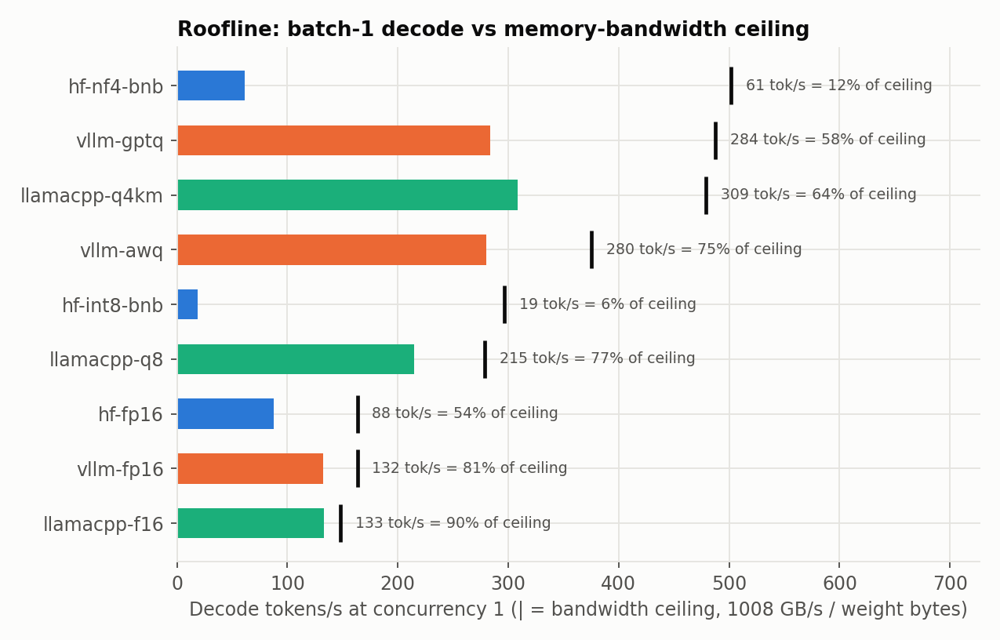

# What does 4-bit actually buy you? Latency, energy and quality for Qwen2.5-3B on an RTX 4090

## 1. Motivation

Inference is the recurring cost of running an LLM, and "just quantize it" is advice that hides two choices: which
precision, and which serving stack. This project measures both on one fixed model and one GPU: Qwen2.5-3B-Instruct on an
RTX 4090, in nine configurations (Hugging Face Transformers, vLLM and llama.cpp, from FP16 down to 4-bit). For each I measured latency,
throughput, memory, GPU energy per token and answer quality, then asked why the numbers come out the way they do.
Every number is reproducible from the repo; every raw run is in `results/runs.jsonl`.

## 2. Setup in brief

One RTX 4090 (24 GB, 450 W limit, full GPU), driver 595.91.07, a RunPod pod. Hugging Face (torch 2.14.1, transformers 5.20.2,
bitsandbytes 0.50.2), vLLM 0.32.0, llama.cpp build 11889. Greedy decoding, exactly 256 generated tokens for every request
(EOS suppressed), prompts of random token ids (128 or 1024 tokens, different per request, prefix caching off). Concurrency 1, 8
and 32. Each cell is the median of 6 measurement windows of at least 10 s, with warmup discarded, spread over 3 rounds in shuffled
config order. **Energy** is the NVML cumulative energy counter before and after each window, divided by generated tokens, so
prefill is included. It covers the **GPU board only**, not CPU, RAM or wall power. **Quality** is WikiText-2 perplexity plus
ARC-Challenge, MMLU and HellaSwag under one zero-shot letter-choice protocol used identically on all stacks. Details and the full
environment are in the README.

## 3. Headline result

Against the unquantized Hugging Face baseline at batch size 1, the 4-bit configs decode **3.2-3.5x faster** and use **62-67% less
energy per token** (vLLM AWQ 280 tok/s and 906 mJ/token, GPTQ 284 and 885, llama.cpp Q4_K_M 309 and 989, versus 88 and 2,640
for HF FP16). They cost between 1.4 (Q4_K_M) and 2.8 (AWQ/GPTQ) mean accuracy points. Compared within a single stack, vLLM AWQ is
2.1x faster than vLLM FP16 with 60% less energy per token for a 2.7-point drop. 8-bit is nearly free in quality (llama.cpp Q8_0:
-0.3 points, which is within noise) but only 1.6x faster than F16.

## 4. Why the numbers look like this: the roofline argument

**Decode is memory-bandwidth-bound at batch size 1.** Producing one token reads every weight once, so the ceiling is
bandwidth divided by weight bytes. The 4090 has about 1,008 GB/s; the FP16 model is 6.2 GB, giving about 163 tok/s, while a 2 GB
4-bit model has a ceiling near 490 tok/s.

| config | weights GB | ceiling tok/s | measured | % of ceiling | time per token above the ideal |
|---|---|---|---|---|---|
| llamacpp-f16 | 6.80 | 148 | 133 | 90% | 0.8 ms |
| vllm-fp16 | 6.17 | 163 | 132 | 81% | 1.5 ms |
| llamacpp-q8 | 3.62 | 279 | 215 | 77% | 1.1 ms |
| vllm-awq | 2.69 | 375 | 280 | 75% | 0.9 ms |
| llamacpp-q4km | 2.10 | 479 | 309 | 64% | 1.2 ms |
| vllm-gptq | 2.07 | 487 | 284 | 58% | 1.5 ms |
| hf-fp16 | 6.17 | 163 | 88 | 54% | 5.3 ms |
| hf-nf4-bnb | 2.01 | 501 | 61 | 12% | 14.4 ms |
| hf-int8-bnb | 3.40 | 297 | 19 | 6% | 50.7 ms |

Two patterns stand out. First, vLLM and llama.cpp sit about 1 ms per token above the bandwidth ideal regardless of
precision. That fixed cost does not shrink with the weights, so a 4-bit model that reads a third of the bytes only gets about 2.2x
the speed, not 3x, and lands at a lower fraction of its (higher) ceiling. Second, the Hugging Face eager path is 5.3 ms above
the ideal even in FP16, versus 1.5 ms for vLLM. That is consistent with Python and kernel-launch overhead that vLLM removes with CUDA graphs
(the vLLM logs show graph capture), but I did not profile it, so treat it as the likely explanation rather than a measured one.

**Prefill is compute-bound, so quantization helps it far less.** At concurrency 1, going from 128 to 1,024 input tokens raises
TTFT from about 10 ms to about 45 ms on vLLM regardless of precision (AWQ, GPTQ and FP16 are indistinguishable), and from 14 to 48
ms on HF FP16. Prefill reuses each weight across many tokens, so it is limited by arithmetic, not by reading weights, which is exactly
what 4-bit weights save (`ttft_vs_input.png`). llama.cpp's TTFT (35-85 ms) includes HTTP and server overhead and should not be compared
directly with the in-process stacks.

**Batching changes the picture.** With 32 concurrent requests the weight reads are shared, so energy per token falls 12-24x
(HF FP16: 2,640 to 113 mJ; vLLM GPTQ: 885 to 53), and the gaps between precisions shrink in relative terms (`energy_vs_concurrency.png`).
But the stack matters more than the precision once the GPU is busy: vLLM AWQ/GPTQ reach about 6,300 tok/s at c=32 and draw about 340 W,
while llama.cpp reaches only 1,400-1,800 tok/s at 150-180 W. Even unquantized HF FP16 (2,449 tok/s) beats every llama.cpp config at c=32. The low
power draw says the llama.cpp GPU is idle much of the time at 32 slots, which points to a host-side or server bottleneck. I did not
test that.

## 5. Surprises and failures

- **bitsandbytes is slow, not fast.** INT8 decodes at 19 tok/s, 4.6x slower than FP16 despite half the weight bytes, and uses
  1.8x the energy per token. NF4 (61 tok/s) is also slower than FP16 (88). Neither comes near its bandwidth ceiling (6% and 12%). The
  per-token overhead (51 ms and 14 ms above the ideal) is not launch cost; it is extra work per layer. The known cause for INT8 is the LLM.int8()
  outlier decomposition, which splits each matmul into an INT8 part and an FP16 part; for NF4, weights are dequantized on the fly. I
  did not profile either here. At c=32, HF INT8 draws only 95 W, so the GPU is mostly waiting.
- **NF4 loses the most quality** of the 4-bit configs: -4.0 mean points and +6.3% perplexity, versus -2.8 for AWQ/GPTQ and -1.4 for
  Q4_K_M. The files are almost the same size (2.10 GB for Q4_K_M, 2.07 GB for GPTQ), so the difference comes from the scheme, not the
  size: Q4_K_M mixes 4- and 6-bit blocks, GPTQ/AWQ use uniform 4-bit groups of 128, and NF4 is a different data type. I did not isolate
  which design choice causes the gap.
- **llama.cpp F16 is the closest to the roofline** (90%) and matches vLLM FP16 (133 vs 132 tok/s), then falls behind vLLM under batching.
- **Failures:** none in the final matrix (324 of 324 windows completed, no throttling). Earlier test runs hit and I fixed: vLLM's FlashInfer sampler
  needing `ninja` on PATH; the F16 GGUF being split into two shards; a llama.cpp log line my GPU-offload check relied on that this
  build no longer prints (replaced by an NVML memory check); and a renamed WikiText dataset id.

## 6. Which config would I deploy?

- **Latency-sensitive single user: llama.cpp Q4_K_M.** About 309 tok/s, 35 ms TTFT, roughly 0.86 s end to end for a 256-token reply,
  and the smallest quality loss of any 4-bit option (-1.4 points). vLLM AWQ/GPTQ are within 7% on latency (about 0.9 s) but lose twice the
  accuracy. If quality matters more than 0.3 s, llama.cpp Q8_0 (1.2 s, no measurable loss) is the safer choice.
- **High-throughput batch service: vLLM AWQ (or GPTQ).** About 6,300 tok/s and 54 mJ/token at c=32 on the short workload (about 2,950 tok/s
  and 124 mJ/token on 1,024-token prompts), 1.9x the throughput of vLLM FP16 at about half the energy per token (54 versus 100 mJ), and 1.5x the KV-cache capacity
  (325k versus 212k tokens at the same memory fraction). The price is about 2.7 accuracy points; if that is unacceptable, vLLM FP16 loses
  nothing and still delivers 3,351 tok/s.

## 7. Limitations

One GPU model, one base model, GPU-board energy only, and quantization schemes that are not equivalent to each other (different bit widths,
group sizes and calibration). Prompts are synthetic random tokens, so they measure speed, not text quality. Accuracy uses a custom zero-shot
letter-choice protocol with 1,000-1,200 items per task, so differences under about 1 point are noise; the 2-4 point drops are reliable.
llama.cpp perplexity uses a different scoring method and is comparable only within llama.cpp. Idle power differs by stack depending on when it was sampled,
so I report raw rather than idle-subtracted energy. I did not run the Zeus energy cross-check; the NVML counter agrees with the integrated power samples
(mean 0.1%, worst window 8.1%), but that is not independent. The overhead explanations in section 4 come from measured per-token times, not profiling.

## 8. What I would do next

Profile the Hugging Face and bitsandbytes decode path (Nsight) to confirm the launch-overhead and dequantization explanations; find the llama.cpp
concurrency bottleneck; run the Zeus cross-check; add FP8 and speculative decoding; repeat on another GPU and a larger model to test whether
the roofline pattern holds; and measure whole-system energy, not just the GPU board.
